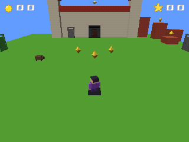
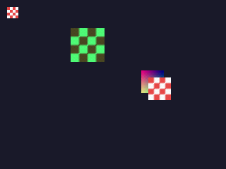
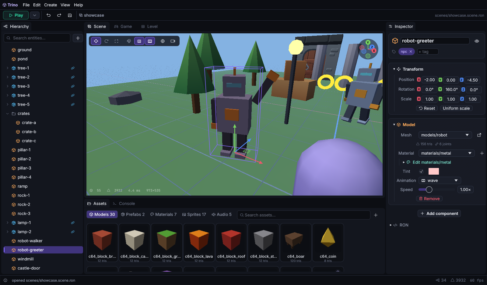

<div align="center">

# Trino

**A cross-platform retro 3D engine for PC, Nintendo 64 and Nintendo 3DS, from one Rust
codebase.**

[](https://github.com/vitorjordao/Trino/actions/workflows/ci.yml)
[](LICENSE-MIT)
[](rust-toolchain.toml)



*castle64, the 3D showcase, played by the engine's test bot. The same crate boots as a
`.z64` on the N64, a `.3dsx` on the 3DS and a native window on PC.*

</div>

---

Your game is a `no_std` Rust crate that depends on one small, dependency-free crate,
`trino-core`. The engine maps it to libdragon on the N64, libctru with citro2d and
citro3d on the 3DS, and wgpu on PC. The N64 sets the ceiling: if a feature cannot run
there, the engine does not expose it. The PC backend can check your content against
each console's budget while you work, so problems show up during development and not at
port time.

The rendering model is low-poly 3D with per-vertex lighting, the kind of art those
consoles were built for. 2D (sprites, text, rectangles, HUDs, billboards, particles,
impostors) is part of the same pipeline, drawn by the same renderer in the same frame.

## Features

| Runtime | PC | Nintendo 64 | Nintendo 3DS |
|---|---|---|---|
| 3D models (`draw_model`), z-buffered | engine T&L, wgpu raster | engine T&L; most static draws run on Trino's RSP overlay | static meshes transformed and lit by the PICA200's vertex shader; the rest engine T&L, citro3d raster with per-vertex depth |
| Surfaces: Gouraud / Flat / Unlit shading, tint, emissive, distance fog, textures, per-draw filter, detail layer | yes | yes | yes |
| Rigid and opt-in smooth skinning, clip crossfade | yes | yes | yes |
| Local point and spot lights | per pixel, up to 8 | per vertex, up to 2 | per vertex, up to 4 |
| Billboards, particles, impostors, distance LOD, portal/cell visibility | yes | yes | yes |
| 2D: sprites, `fill_rect`, bitmap text | yes | yes | yes |
| Two screens | simulated by the 3DS profile | one screen | top 400x240 and touch bottom 320x240 |
| Input | keyboard, mouse, gamepads (feature `gamepad`), rebinding | controller | buttons, circle pad, touch |
| Audio: SFX, music, stingers, positional sound | yes | yes | yes |
| Save data | file | 16 Kbit EEPROM | SD card |

| Tooling | What you get |
|---|---|
| Console looks on PC | `TRINO_SIM=n64` emulates the N64 output (3-point filtering, the RDP dither rule, the VI dedither pass), checked against ares frames; `TRINO_SIM=3ds` gives the 3DS resolution, bilinear sampling and both screens. Strict mode (`TRINO_STRICT=1`) fails a frame that exceeds the console's budget. |
| Asset pipeline | One master per asset, optional per-platform overrides, per-console formats baked at build time. glTF becomes TMDL, the engine's portable mesh format. Placeholder "fake objects" you can swap for real art later without touching references. |
| Blender automation | Python helpers in `tools/blender/` and `cargo xtask blender` commands that build, check and export models within the N64 budget. |
| Authored content as text | Scenes, prefabs, materials, particle effects and fake objects are RON files. The editor writes them, any tool or AI agent can edit them, and a running editor or game reloads them live. |
| Editor | Scene and Game views on the real renderer, hierarchy, inspector, asset browser, prefabs, per-platform variants, LOD and impostor baking, an animation tab, a per-console frame budget HUD. |
| Live reload | Game code reloads as a dylib on PC (`cargo xtask watch pc`); consoles rebuild and relaunch in the emulator on save (`watch n64`, `watch 3ds`). |
| Emulator self-tests and goldens | `cargo xtask test n64` and `test 3ds` boot the game in ares or Azahar, run a self-test step for every engine service, have a bot play a stage, and compare frames with golden images. The N64 run also gates frame time. |
| Real hardware | `run n64 --device sc64\|everdrive` and `run 3ds --device network` deploy to a console and print its debug log in your terminal. Tested with stub loaders so far ([docs/HARDWARE.md](docs/HARDWARE.md)). |

## Platform capabilities

The numbers come from `Caps` in [`crates/core/src/caps.rs`](crates/core/src/caps.rs), the
tables that strict mode and the tools check content against.

| | PC | Nintendo 64 | Nintendo 3DS |
|---|---|---|---|
| Internal resolution | 1920x1080 by default [^pc-res] | 320x240 | 400x240 (top) [^3ds-bottom] |
| Color depth | 32-bit | 16-bit | 24-bit |
| Texture memory | no limit | 4 KB (TMEM) | 6 MB |
| Largest texture side | 4096 | 256 | 1024 |
| Sprites per frame (strict-mode budget) | no limit | 512 | 4096 |
| Triangles per frame (rasterizer cap) | no limit | 4000 [^n64-tris] | 60000 |
| 3D time per frame (strict mode) | no limit | 50 ms estimated [^n64-time] | no limit |
| Save data | 1 MB | 2048 bytes (16 Kbit EEPROM) | 64 KB |
| Local light tier | per pixel | per vertex | per vertex |
| Local lights per frame | 8 | 2 | 4 |

[^pc-res]: The PC's internal picture follows the active console-simulation profile
    (`TRINO_SIM=native|n64|3ds`), not this table.
[^3ds-bottom]: `Caps` describes the top screen. The bottom touch screen is 320x240
    (`Renderer::on_screen(Screen::Bottom)`).
[^n64-tris]: Not the real limit. A 30 fps frame affords roughly 550 to 650 source
    triangles of CPU T&L, fewer with many draws; draws on the RSP cost much less. Use
    `cargo xtask model inspect` and `cargo xtask scene budget` for the N64 cost estimate.
[^n64-time]: As estimated by the calibrated cost model (`trino_core::perf::N64_COST`).
    Tools warn earlier, above a 30 fps frame.

## Quickstart

### Prerequisites

- Rust through [rustup](https://rustup.rs). The workspace builds on stable
  (`rust-toolchain.toml` picks it). Console builds also need nightly:
  `rustup toolchain install nightly --component rust-src`.
- Linux: `pkg-config` and the ALSA headers (`libasound2-dev`).
- N64: Docker, and the [ares](https://ares-emu.net) emulator at `ares-v148/` in the repo
  root (or a headless image, see below).
- 3DS: a [devkitPro](https://devkitpro.org/wiki/Getting_Started) install with the
  `3ds-dev` packages, and the [Azahar](https://azahar-emu.org) emulator.

### PC

```sh
git clone https://github.com/vitorjordao/Trino
cd Trino
cargo xtask run pc     # play castle64 (N64 look by default; TRINO_SIM=native|3ds)
cargo xtask editor     # the editor's project launcher (`cargo xtask editor .`: the engine's scenes)
cargo xtask test       # the workspace test suite, as CI runs it
```

### Nintendo 64 and Nintendo 3DS

```sh
cargo xtask run n64    # build target/n64/trino.z64 (Docker toolchain) and open it in ares
cargo xtask test n64   # boot the self-test ROM: every step, the golden frame, the perf gates
cargo xtask run 3ds    # build target/3ds/trino.3dsx (local devkitPro) and open it in Azahar
cargo xtask test 3ds   # boot the self-test app: every step and the golden frames
cargo xtask watch n64  # rebuild and relaunch on every save (watch 3ds too)
```

No emulator installed? `cargo xtask emulators setup ares` builds a headless ares image
(then run with `TRINO_ARES=docker`), and `cargo xtask emulators setup azahar` fetches the
pinned Azahar AppImage (Linux x86_64). Details per platform:
[docs/PLATFORMS.md](docs/PLATFORMS.md).

### A new game

```sh
cargo xtask new my-game      # examples/my-game: a game crate and its AGENTS.md
cargo test -p my-game        # its tests join the workspace suite
```

Game crates depend only on `trino-core`, and `xtask/tests/dep_graph.rs` enforces it, so
a game builds for all three targets by construction.

To start a project outside this repository:

```sh
cargo xtask new space-cat --standalone ~/games/space-cat    # engine as path dependencies
#   or: --git https://github.com/vitorjordao/Trino --rev <commit>
cd ~/games/space-cat && cargo run -p space-cat-pc           # TRINO_SIM=3ds for the 3DS look
cargo trino build n64                                       # the engine's xtask, for this project
```

`--template football` starts from Solid Eleven, the football game; `castle64` and
`showcase` start from those demos.

A standalone project has its own workspace: the portable `game/` crate, a PC host on
`trino-runner-pc` with live asset reload, `n64/` and `n3ds/` console crates, starter
assets, a `trino.toml` and an `AGENTS.md`. Console builds need a local engine checkout
(a path dependency or an `engine/` git submodule), because the shims, the target spec and
the Docker image live there ([ADR 0008](docs/adr/0008-external-console-projects.md)).

## Examples

| Crate | What it is |
|---|---|
| [`examples/castle64`](examples/castle64) | The 3D showcase and the default game of every app: a hub, three platforming stages and a throne room, an articulated character, a map on the 3DS bottom screen. Its `selftest` module holds the console self-test steps, and a bot plays it in the tests. |
| [`examples/solid-eleven`](examples/solid-eleven) | **Solid Eleven**, a low-poly 3D football game and the `football` project template (`cargo xtask new <name> --standalone <dir> --template football`). It has full referee rules, ball physics with curl, a tactical AI, ten balanced clubs, a career with transfers and saves, menus in English and Portuguese, and a touch-screen radar on the 3DS. Run it with `TRINO_GAME=solid-eleven cargo run -p trino-app-pc`. The guide is [docs/SOLID_ELEVEN.md](docs/SOLID_ELEVEN.md). |
| [`examples/showcase`](examples/showcase) | The editor's demo scene (`scenes/showcase.scene.ron`) exported to `no_std` Rust data. Run it with `TRINO_GAME=showcase cargo run -p trino-app-pc`; a test proves it renders like the scene itself. |
| [`examples/platformer`](examples/platformer) | **Legacy.** A 2D tilemap platformer from the engine's first phases. Kept for a PC golden test and the editor's Level tab; not the model for new games. |
| [`examples/hello-sprite`](examples/hello-sprite) | **Legacy.** The minimal sprite example. Kept because the hot-reload end-to-end test builds it. |

## In pictures

| N64 look on PC | The editor |
|---|---|
|  |  |
| 3-point filtering and the RDP's dither, quantized to RGBA5551 in the PC shader, so the preview matches the console. | The showcase scene, built from fake objects, two prefabs, materials and animated models. Every panel writes a text file. |
| **Solid Eleven on the N64 (ares)** | **Solid Eleven's transfer market (PC)** |
|  |  |
| Twenty-two players, the referee and the stadium at about 26 ms a frame in ares, with every draw on the RSP but one. | Menus after the issue's concept art: `fill_rect` panels and bitmap text, so they run on the consoles too. |

## How it works

```
            ┌──────────── your game ────────────┐
            │   depends ONLY on trino-core      │
            └───────────────┬───────────────────┘
                            ▼
            trino-core  (traits, math, T&L; no_std, zero deps)
                            ▲
        ┌───────────────────┼───────────────────┐
  platform-pc         platform-n64         platform-3ds
  (wgpu/winit)        (libdragon FFI)      (libctru/citro FFI)
```

- **The engine transforms and lights 3D itself.** `trino-core` runs a deterministic
  software T&L, and backends rasterize screen-space triangles. On the N64 most static
  draws run the same math on Trino's own RSP microcode instead.
- **Materials are presets, not shaders.** A surface is plain data (`ModelParams`) that
  every target evaluates the same way.
- **Assets have shared masters and per-platform overrides.** A format a console can't
  represent is a bake error, never a silent fallback.
- **Everything goes through `cargo xtask`:** build, run, test, bake, watch, scaffold,
  inspect.

More in [docs/ARCHITECTURE.md](docs/ARCHITECTURE.md).

## Roadmap

The ranked list is [docs/BACKLOG.md](docs/BACKLOG.md). In short:

- **N64 RSP path:** measure on real hardware (ares does not time the RDP), clip on the
  RSP, and cover more surface features there (flat shading, fog, colored light, emissive,
  textures, skeletons, palettes, point lights), with an RSP term in the cost model.
- **First release:** freeze the `TSCN` format at v1, and publish `trino-core`,
  `trino-game-api` and `trino-runner-pc` to crates.io.
- **Picture quality:** N64 depth precision (a decal mode), RDP antialiasing with the VI's
  AA stage, PICA200 per-fragment lighting on the 3DS.
- **Content:** lights in scenes and the editor, palettes in materials and scenes, scene
  streaming for levels larger than RAM.
- **Hardware and input:** the first runs of the deploy commands on physical consoles,
  the N64 mouse, gamepads on Linux without libudev at build time.
- **2D:** a redesigned 2D sprite and tile system, built on the unified pipeline, is
  planned for a future release. It will replace the legacy 2D examples.

## Documentation

- [docs/README.md](docs/README.md): the index of guides, ADRs and plans.
- [AGENTS.md](AGENTS.md): the full guide for contributors and AI agents (Claude Code,
  Codex, Gemini CLI, Cursor, Copilot): repository map, rules, every command, pitfalls.
  Workflows live as skills in `.agents/skills/`.
- [docs/TESTING.md](docs/TESTING.md): which test proves each feature.
- [CONTRIBUTING.md](CONTRIBUTING.md): setup and the pull request workflow.

## License

Dual-licensed under [MIT](LICENSE-MIT) or [Apache-2.0](LICENSE-APACHE), at your option.
