<div align="center">

<picture>
  <source media="(prefers-color-scheme: dark)" srcset="docs/media/trino-logo-dark.png">
  <source media="(prefers-color-scheme: light)" srcset="docs/media/trino-logo-light.png">
  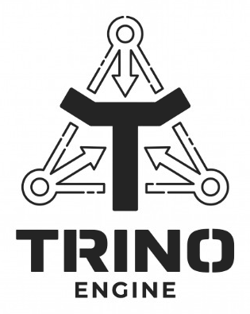
</picture>

# Trino

### Write your game once in Rust. Ship it on the Nintendo 64, the Nintendo 3DS, PC and the browser.

[](https://github.com/vitorjordao/Trino/actions/workflows/ci.yml)
[](LICENSE-MIT)
[](rust-toolchain.toml)


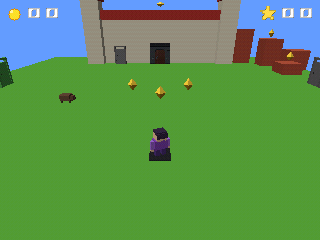

*castle64, played by the engine's own test bot. The same crate boots as a `.z64` on the
N64, a `.3dsx` on the 3DS, a native window on PC and a tab in your browser.*

[Quickstart](#quickstart) · [Why Trino](#why-trino) · [Games](#games-made-with-it) ·
[The editor](#an-editor-for-humans-and-ai-agents) · [Features](#everything-in-the-box) ·
[Docs](docs/README.md)

</div>

---

## One scene, three machines

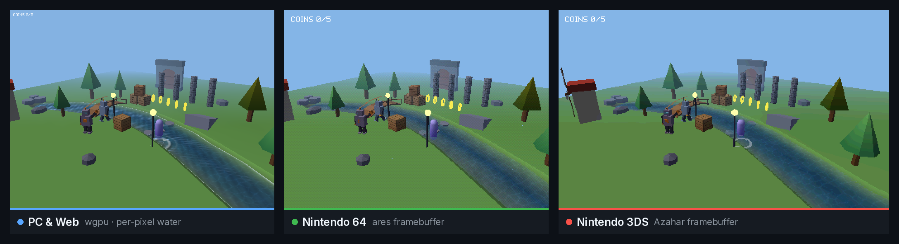

The same scene file, the same game code, the same camera. The console frames are not
mockups: they are framebuffers dumped from the ares and Azahar emulators, and CI compares
them with these goldens on every pull request. The river flows and ripples on all three; each machine does it with the hardware it has.

## Why Trino

- **One portable game crate.** Your game is a `no_std` Rust crate that depends on one
  small crate with zero dependencies, `trino-core`. A test enforces it, so a game that
  builds for PC builds for the consoles by construction.
- **Real console hardware, not a retro filter.** The engine runs its own microcode on the
  N64's RSP (most draws; castle64's hub went 38 → 13 ms in ares), transforms static meshes on the 3DS's
  PICA200, and draws with wgpu (WebGPU or WebGL2) on PC and the Web.
- **The best each console can do, from one asset.** Lights, water, shadows, ambient
  occlusion and post-processing each have a tier per machine: per pixel on PC, per vertex
  or baked on the consoles. You author once; the engine picks the tier.
- **Budgets you see while you work.** Run on PC with the N64 or 3DS look, and strict mode
  fails a frame that would bust the console's triangles, TMEM, RAM or frame time. The
  editor shows each console's frame cost per object, before any port.
- **Everything is text, and everything hot-reloads.** Scenes, prefabs, materials,
  particles, UI screens and string tables are RON files. Save game code and the running
  game swaps it in. An AI agent edits the same files as the editor and sees the result
  live, with skills for Claude Code, Codex, Gemini CLI, Cursor and Copilot.
- **Tested in the emulators, every commit.** CI boots the ROM in ares and the app in
  Azahar, runs a self-test step for every engine service, lets a bot play a stage,
  compares golden frames and gates the N64 frame time. The Web runs in Chromium, Firefox
  and WebKit.
- **Ready to ship.** Achievements, Steam (stats, overlay, Steam Input; tested against a
  mock store so far), packages per OS
  (AppImage, `.exe`, `.app`/`.dmg`), a 3DS `.cia`, crash reports, localization,
  accessibility settings, local multiplayer, replays and rollback netplay.

## Games made with it

### Solid Eleven, a low-poly football game

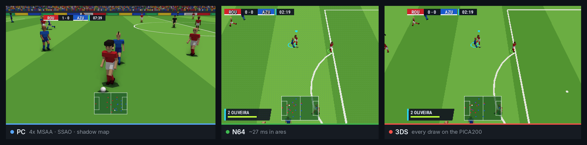

Twenty-two players, a referee and a stadium. Offside, fouls, cards and penalties, a ball
with curl and bounces, a tactical AI per club, a career with transfers and saves, menus in
English and Portuguese. On the N64 the match runs at about 27 ms a frame in ares, with its
draws on the RSP. It is also a project template:
`cargo xtask new my-cup --standalone ~/games/my-cup --template football`.

| | |
|---|---|
| 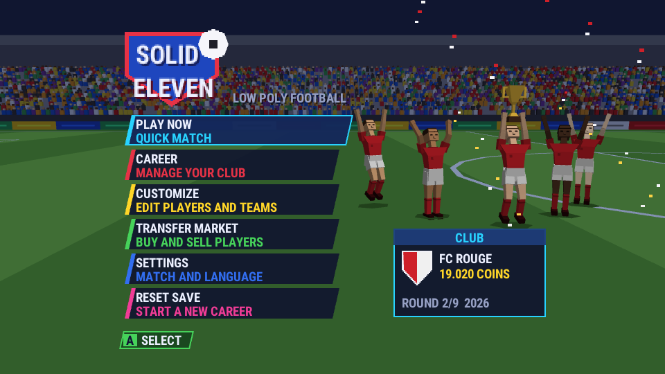 | 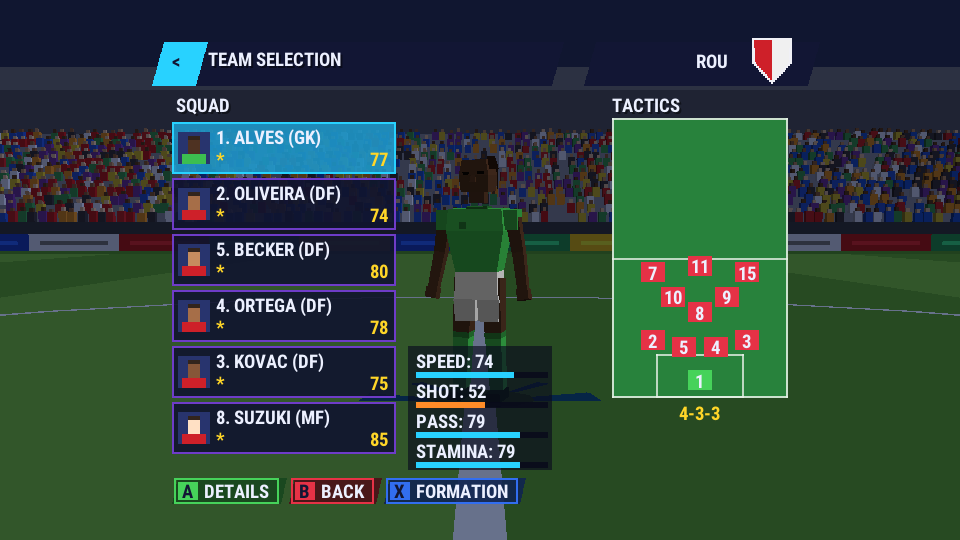 |

### Two screens and a touch panel on the 3DS

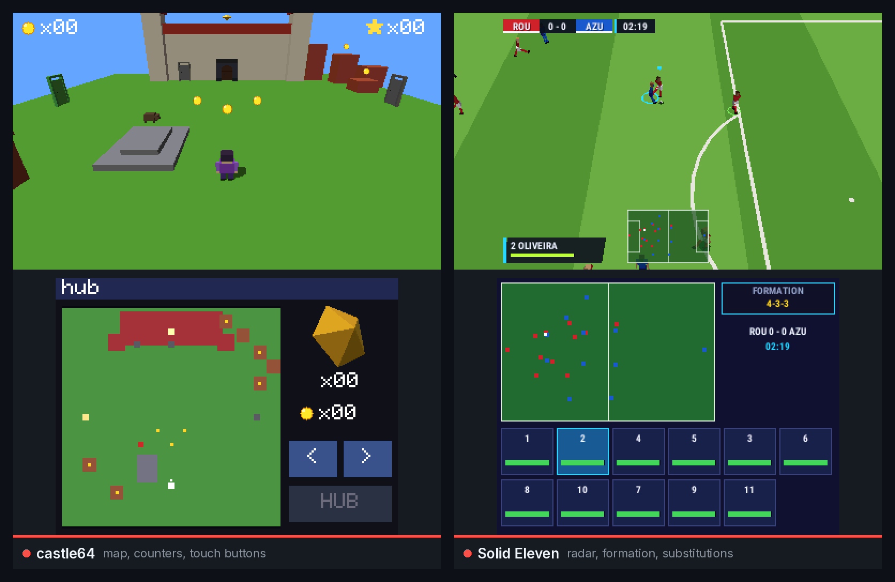

`Renderer::on_screen(Screen::Bottom)` sends 2D and 3D to the touch screen. On PC the 3DS
profile draws both screens stacked and maps the mouse to the touch one.

## The best tier on every console

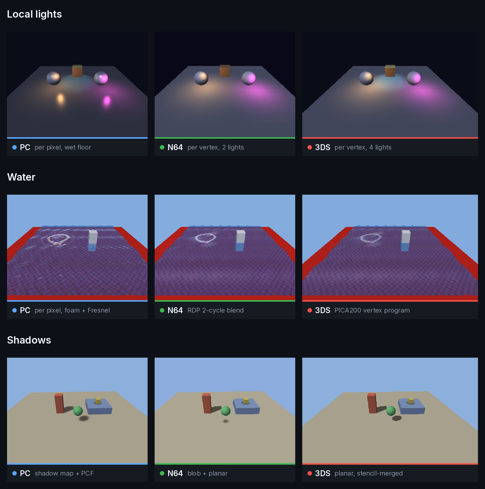

One `LocalLight`, one water material, one `ShadowCast` per model. The PC gets per-pixel
light, foam and a filtered shadow map; the N64 gets per-vertex light, the RDP's two-cycle
texture blend and blob shadows; the 3DS gets four lights, a vertex program on the PICA200
and stencil-merged planar shadows. The PC can preview every console's version while you
work: these frames come from the PC's N64 and 3DS profiles, which follow each console's
own path; parity tests hold those profiles close to the ares and Azahar frames.

## An editor for humans and AI agents

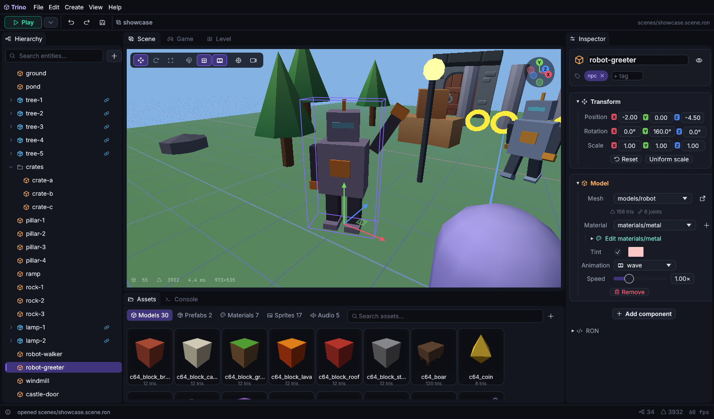

| | |
|---|---|
| 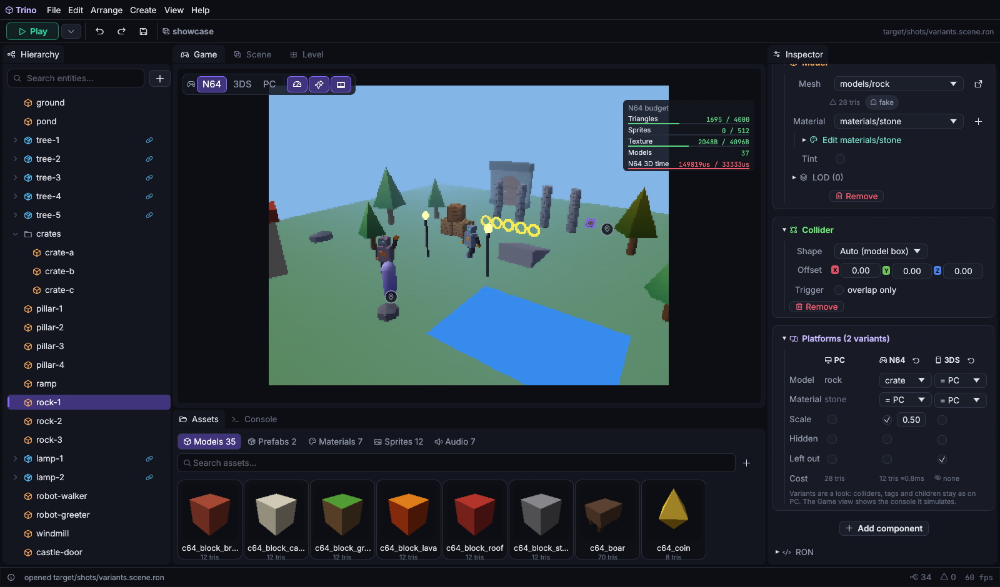 | 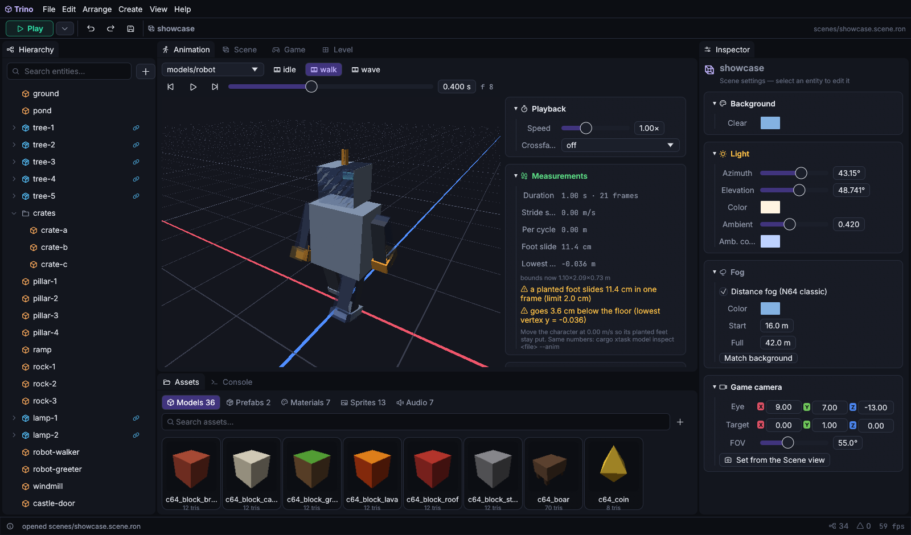 |
| **Per-platform variants and budgets.** The Game view shows the scene as an N64, a 3DS, a PC or a browser draws it, with that machine's frame cost. Swap a model, a material or a scale per console. | **Animation you can measure.** Clips, crossfades, graphs and layers, with warnings for foot slide and feet under the floor. |

Scene and Game views on the real renderer, prefabs with overrides, a move/rotate/scale
gizmo, LOD chains and impostor baking, particles, UI screens, localization, an audio mixer,
a memory planner, a profiler and an accessibility simulator. Every panel writes a text
file, so `git diff` shows what changed and an AI agent can do anything you can.

## Quickstart

Three commands from a fresh clone to playing, editing and testing:

```sh
git clone https://github.com/vitorjordao/Trino && cd Trino
cargo xtask run pc       # play castle64 with the N64 look (TRINO_SIM=native for the PC's, =3ds for the 3DS's)
cargo xtask editor .     # open the editor on the engine's own scenes
```

Then try `cargo xtask run web` (the same game in your browser), `cargo xtask run n64`
(the ROM in ares) or `TRINO_GAME=solid-eleven cargo run -p trino-app-pc` (the football game).

### Prerequisites

- Rust through [rustup](https://rustup.rs). The workspace builds on stable
  (`rust-toolchain.toml` picks it). Console builds also need nightly:
  `rustup toolchain install nightly --component rust-src`.
- Linux: `pkg-config` and the ALSA headers (`libasound2-dev`).
- N64: Docker, and the [ares](https://ares-emu.net) emulator at `ares-v148/` in the repo
  root (or a headless image, see below).
- 3DS: a [devkitPro](https://devkitpro.org/wiki/Getting_Started) install with the
  `3ds-dev` packages, and the [Azahar](https://azahar-emu.org) emulator.

### PC

```sh
git clone https://github.com/vitorjordao/Trino
cd Trino
cargo xtask run pc     # play castle64 (N64 look by default; TRINO_SIM=native|3ds)
cargo xtask editor     # the editor's project launcher (`cargo xtask editor .`: the engine's scenes)
cargo xtask test       # the workspace test suite, as CI runs it
```

### Nintendo 64 and Nintendo 3DS

```sh
cargo xtask run n64    # build target/n64/trino.z64 (Docker toolchain) and open it in ares
cargo xtask test n64   # boot the self-test ROM: every step, the golden frame, the perf gates
cargo xtask run 3ds    # build target/3ds/trino.3dsx (local devkitPro) and open it in Azahar
cargo xtask test 3ds   # boot the self-test app: every step and the golden frames
cargo xtask watch n64  # rebuild and relaunch on every save (watch 3ds too)
```

### Web

```sh
cargo xtask run web    # build the wasm, serve it on 127.0.0.1 and open the browser (WebGPU or WebGL2)
cargo xtask run web --query "?game=solid-eleven"
cargo xtask test web   # the self-test in Chromium, Firefox and WebKit (Playwright; needs Node.js)
cargo xtask build web --release --out dist/web   # a folder to upload to itch.io or GitHub Pages
```

No emulator installed? `cargo xtask emulators setup ares` builds a headless ares image
(then run with `TRINO_ARES=docker`), and `cargo xtask emulators setup azahar` fetches the
pinned Azahar AppImage (Linux x86_64). Details per platform:
[docs/PLATFORMS.md](docs/PLATFORMS.md).

### A new game

```sh
cargo xtask new my-game      # examples/my-game: a game crate and its AGENTS.md
cargo test -p my-game        # its tests join the workspace suite
```

Game crates depend only on `trino-core`, and `xtask/tests/dep_graph.rs` enforces it, so
a game builds for all three targets by construction.

To start a project outside this repository:

```sh
cargo xtask new space-cat --standalone ~/games/space-cat    # engine as path dependencies
#   or: --git https://github.com/vitorjordao/Trino --rev <commit>
cd ~/games/space-cat && cargo run -p space-cat-pc           # TRINO_SIM=3ds for the 3DS look
cargo trino build n64                                       # the engine's xtask, for this project
```

`--template football` starts from Solid Eleven, the football game; `castle64` and
`showcase` start from those demos.

A standalone project has its own workspace: the portable `game/` crate, a PC host on
`trino-runner-pc` with live asset reload, `n64/` and `n3ds/` console crates, starter
assets, title, pause, options and controls screens in `ui/`, a `trino.toml` and an `AGENTS.md`. Console builds need a local engine checkout
(a path dependency or an `engine/` git submodule), because the shims, the target spec and
the Docker image live there ([ADR 0008](docs/adr/0008-external-console-projects.md)).

## Everything in the box

- **Rendering:** z-buffered low-poly 3D with Gouraud, flat and unlit shading, textures
  in each console's own formats, rigid and smooth skinning, local lights, ambient
  occlusion, shadows, water, fog, post-processing (tonemap, bloom, LUT grading),
  billboards, particles, impostors, LOD and portal visibility. 2D sprites, text and UI in
  the same frame.
- **Game services:** input with rebinding and gamepad glyphs per family, up to four local
  players, positional audio with buses and streaming, saves in two slots that survive a damaged write,
  asset groups that stream against a RAM budget per console, quality presets with
  dynamic resolution on PC and the Web, the Expansion Pak and the New 3DS detected at boot.
- **Content as data:** scenes, prefabs, materials, particle effects, animation graphs, UI
  screens and string tables in RON; glTF models from Blender with scripted helpers;
  placeholder "fake objects" you swap for real art later without touching a reference.
- **Players first:** localization with plurals and locale formats, fonts baked with only
  the glyphs each language uses, color-vision palettes, captions, 200 % text, high
  contrast, a flash guard and hold-to-toggle ([docs/ACCESSIBILITY.md](docs/ACCESSIBILITY.md)).
- **Online:** input recordings that replay bit for bit on every target, rollback netplay
  over UDP or WebRTC with a lobby by room code, spectators, and lockstep between two 3DS
  over local wireless (tested in two Azahar instances).
- **Shipping:** achievements and stats on every target, Steam, itch.io, signed packages
  per OS, the Steam Deck checklist, crash reports with consent and the 3DS `.cia`
  ([docs/SHIPPING.md](docs/SHIPPING.md)).

<details>
<summary><b>Runtime features per platform</b> (the full table)</summary>

| Runtime | PC | Nintendo 64 | Nintendo 3DS |
|---|---|---|---|
| 3D models (`draw_model`), z-buffered | engine T&L, wgpu raster | engine T&L; most static draws run on Trino's RSP overlay | static meshes transformed and lit by the PICA200's vertex shader; the rest engine T&L, citro3d raster with per-vertex depth |
| Surfaces: Gouraud / Flat / Unlit shading, tint, emissive, distance fog, textures, per-draw filter, detail layer | yes | yes | yes |
| Rigid and opt-in smooth skinning, clip crossfade | yes | yes | yes |
| Local point and spot lights | per pixel, up to 8 | per vertex, up to 2 | per vertex, up to 4 |
| Ambient occlusion | screen-space (SSAO), plus baked | baked into vertex colors (`ao` in the manifest) | baked into vertex colors |
| Shadows (`ModelParams::shadow`, scene receivers) | a shadow map with PCF on every surface (and the Web) | a soft blob per caster on the surface under it; two projected shapes a frame | the caster's shape projected onto the surface under it, stencil-merged |
| Post-processing (`Renderer::set_post`): tonemap, bloom, LUT grading, vignette, grain | HDR stack with bloom (and the Web) | the LUT baked into colors, glow halos for bloom | the LUT baked into colors, glow halos for bloom |
| Water surfaces: flowing layers, swell, ripples, Fresnel, glint | per pixel, with shore foam | per vertex, RDP 2-cycle layer blend | PICA200 vertex program, TexEnv layer blend |
| Billboards, particles, impostors, distance LOD, portal/cell visibility | yes | yes | yes |
| 2D: sprites, `fill_rect`, bitmap text | yes | yes | yes |
| UI screens (`ui/*.ui.ron`): layout per target, focus by pad, mouse or touch, string tables | 1080p ×4, 4K ×9, 21:9; mouse | inside the TV-safe area; pad and C buttons | touch screen nodes and taps |
| Localization (`assets/i18n/<lang>.ron`): fallback, plurals, number/money/date formats, fonts subset per language | the OS language (`TRINO_LANG`), the browser's on the Web | the game's default, then the saved choice; atlases sized for TMEM | the system language |
| Two screens | simulated by the 3DS profile | one screen | top 400x240 and touch bottom 320x240 |
| Input | keyboard, mouse, gamepads (feature `gamepad`), rebinding | controller | buttons, circle pad, touch |
| Local players (`Platform::players`) | up to 4: the keyboard and each pad by seat, bindings per player, a join screen helper | 4 controller ports | 1 |
| Input recordings and replays (`TREC`), checked by state hash | record and replay (`TRINO_RECORD`, `TRINO_REPLAY`; `?record`, `?replay=` on the Web), crash reports keep the last minute | replay and record over the debug channel | replay and record over the debug channel |
| Online play: rollback (GGPO's model) or delay-based lockstep | UDP, a lobby by room code (and WebRTC on the Web) | local only | local only (local wireless evaluated) |
| Stereoscopic 3D (`Renderer::set_stereo`): one eye per pass while the slider is up | anaglyph and side-by-side previews | no | the top screen, with a time budget that falls back to 2D |
| Animation: clip events, root motion, compression, foot IK, graphs, joint-masked and additive layers, 2D blend spaces, crowds | yes | yes (IK off by default) | yes |
| Physics (`trino_core::physics`): grid queries, exact casts against boxes, ramps and meshes, triggers, a character controller with steps and slopes, per-cell worlds | yes, the same bits on every target | yes | yes |
| Audio: SFX, music, stingers, positional sound | yes | yes | yes |
| Save data | file | 16 Kbit EEPROM | SD card |
| Quality presets (Low…Ultra): auto-detect, dynamic resolution, frame cap, a Graphics options page | yes (and the Web; Steam Deck preset) | fixed | fixed |
| Accessibility: color vision through semantic palettes and icons, text scale and high contrast, captions, reduced motion, a flash guard, hold-to-toggle ([docs/ACCESSIBILITY.md](docs/ACCESSIBILITY.md)) | yes; settings saved for the player, plus a color-vision simulation view | yes; settings for the session (3 bytes in a game's save) | yes; captions on the touch screen if asked |

In this table the browser runs the PC column: the same renderer, on WebGPU or WebGL2.

</details>

<details>
<summary><b>Tooling</b> (the full table)</summary>

| Tooling | What you get |
|---|---|
| Console looks on PC | `TRINO_SIM=n64` emulates the N64 output (3-point filtering, the RDP dither rule, the VI dedither pass), checked against ares frames; `TRINO_SIM=3ds` gives the 3DS resolution, bilinear sampling and both screens. Strict mode (`TRINO_STRICT=1`) fails a frame that exceeds the console's budget. |
| Asset pipeline | One master per asset, optional per-platform overrides, per-console formats baked at build time. glTF becomes TMDL, the engine's portable mesh format. Placeholder "fake objects" you can swap for real art later without touching references. |
| Blender automation | Python helpers in `tools/blender/` and `cargo xtask blender` commands that build, check and export models within the N64 budget. |
| Authored content as text | Scenes, prefabs, materials, particle effects, fake objects and UI screens are RON files. The editor writes them, any tool or AI agent can edit them, and a running editor or game reloads them live. |
| Editor | Scene and Game views on the real renderer, hierarchy, inspector, asset browser, prefabs, per-platform variants, LOD and impostor baking, an animation tab, a per-console frame budget HUD, each console's shadow tier in the Game view. |
| UI tools | `cargo xtask ui check` proves on every target that the pad reaches every control, the screen fits the console's UI budget and no translation overflows; `ui shot` renders a screen as a target shows it; the editor's UI tab edits screens with a focus-order overlay. Every new project starts with title, pause, options and controls screens. |
| Accessibility tools | `cargo xtask access check` proves semantic colors stay apart and readable in every color-vision mode, the high-contrast theme keeps 7:1, every caption key exists in every language and every screen fits at 200 % text on every target; `access shot` renders a screen or scene as a player with those settings sees it; the editor's Accessibility tab simulates color vision in every view and edits the palettes. New projects start with an Accessibility screen. |
| Localization tools | `cargo xtask i18n check` holds every language to its keys, placeholders, plural forms, the glyphs its fonts bake and every UI box on every target; `i18n pseudo` finds hard-coded text and tight boxes; CSV for translators; the editor's Localization tab edits the tables. |
| Live reload | Game code reloads as a dylib on PC (`cargo xtask watch pc`); consoles rebuild and relaunch in the emulator on save (`watch n64`, `watch 3ds`). |
| Replays and netplay | `cargo xtask replay dump\|run\|check` reads a recording and replays it on any target; every build replays a PC recording in ares, Azahar and the browsers and holds them to the same state hashes. `cargo xtask net local\|web` plays two instances online with a simulated network; the editor records, replays and scrubs Play here sessions and simulates 2–4 local players ([ADR 0036](docs/adr/0036-players-replays-netplay.md)). |
| Profiler | `zone!` marks in game and engine code, one trace format from every target (ares and Azahar included), viewed in Perfetto, Tracy on the PC or the editor's Profiler tab; compiled out unless asked for ([ADR 0030](docs/adr/0030-unified-profiler.md)). |
| Robustness | 37 fuzz targets over every parser and save format, saves in A/B slots that survive a cut, Miri and AddressSanitizer in CI ([ADR 0037](docs/adr/0037-robustness-fuzzing-and-save-recovery.md)). |
| Emulator self-tests and goldens | `cargo xtask test n64` and `test 3ds` boot the game in ares or Azahar, run a self-test step for every engine service, have a bot play a stage, and compare frames with golden images. The N64 run also gates frame time. |
| Real hardware | `run n64 --device sc64\|everdrive` and `run 3ds --device network` deploy to a console and print its debug log in your terminal. Tested with stub loaders so far ([docs/HARDWARE.md](docs/HARDWARE.md)). |

</details>

<details>
<summary><b>Platform capabilities</b> (the budgets strict mode checks)</summary>

The numbers come from `Caps` in [`crates/core/src/caps.rs`](crates/core/src/caps.rs), the
tables that strict mode and the tools check content against.

| | PC | Web | Nintendo 64 | Nintendo 3DS |
|---|---|---|---|---|
| Internal resolution | 1920x1080 by default [^pc-res] | the canvas over the pixel scale | 320x240 | 400x240 (top) [^3ds-bottom] |
| Color depth | 32-bit | 32-bit | 16-bit | 24-bit |
| Texture memory | no limit | 1 GB | 4 KB (TMEM) | 6 MB |
| Largest texture side | 4096 | 4096 | 256 | 1024 |
| Sprites per frame (strict-mode budget) | no limit | no limit | 512 | 4096 |
| Triangles per frame (rasterizer cap) | no limit | 1 000 000 | 4000 [^n64-tris] | 60000 |
| 3D time per frame (strict mode) | no limit | no limit | 50 ms estimated [^n64-time] | no limit |
| Save data | 1 MB | 1 MB (`localStorage`) | 2048 bytes (16 Kbit EEPROM) | 64 KB |
| Local light tier | per pixel | per pixel | per vertex | per vertex |
| Local lights per frame | 8 | 8 | 2 | 4 |
| Ambient occlusion tier | screen-space | screen-space | baked | baked |
| Shadow tier | map | map | blob (2 planar a frame) | planar |
| Quality presets | Low…Ultra, auto-detected | Low…Ultra (phones Low) | fixed Low | fixed Low (New 3DS Medium) |
| Post tier | full (HDR) | full (HDR) | baked | baked |
| Water tier | per pixel | per pixel | per vertex | vertex program |
| Ripples per frame | 4 | 4 | 4 | 4 |
| UI nodes / 2D draws per frame | 512 / 16384 | 512 / 16384 | 64 / 384 | 128 / 2048 |
| UI safe area | none | the notch (CSS safe-area insets) | 16x12 (TV overscan) | none |

[^pc-res]: The PC's internal picture follows the active console-simulation profile
    (`TRINO_SIM=native|n64|3ds`), not this table.
[^3ds-bottom]: `Caps` describes the top screen. The bottom touch screen is 320x240
    (`Renderer::on_screen(Screen::Bottom)`).
[^n64-tris]: Not the real limit. A 30 fps frame affords roughly 550 to 650 source
    triangles of CPU T&L, fewer with many draws; draws on the RSP cost much less. Use
    `cargo xtask model inspect` and `cargo xtask scene budget` for the N64 cost estimate.
[^n64-time]: As estimated by the calibrated cost model (`trino_core::perf::N64_COST`).
    Tools warn earlier, above a 30 fps frame.

</details>

## Examples

| Crate | What it is |
|---|---|
| [`examples/castle64`](examples/castle64) | The 3D showcase and the default game of every app: a hub, three platforming stages and a throne room, an articulated character, a map on the 3DS bottom screen. Its `selftest` module holds the console self-test steps, and a bot plays it in the tests. |
| [`examples/solid-eleven`](examples/solid-eleven) | **Solid Eleven**, a low-poly 3D football game and the `football` project template (`cargo xtask new <name> --standalone <dir> --template football`). It has full referee rules, ball physics with curl, a tactical AI, ten balanced clubs, a career with transfers and saves, menus in English and Portuguese, and a touch-screen radar on the 3DS. Run it with `TRINO_GAME=solid-eleven cargo run -p trino-app-pc`. The guide is [docs/SOLID_ELEVEN.md](docs/SOLID_ELEVEN.md). |
| [`examples/showcase`](examples/showcase) | The editor's demo scene (`scenes/showcase.scene.ron`) exported to `no_std` Rust data. Run it with `TRINO_GAME=showcase cargo run -p trino-app-pc`; a test proves it renders like the scene itself. |
| [`examples/platformer`](examples/platformer) | **Legacy.** A 2D tilemap platformer from the engine's first phases. Kept for a PC golden test and the editor's Level tab; not the model for new games. |
| [`examples/hello-sprite`](examples/hello-sprite) | **Legacy.** The minimal sprite example. Kept because the hot-reload end-to-end test builds it. |


## How it works

```
                  ┌───────────── your game ─────────────┐
                  │     depends ONLY on trino-core      │
                  └──────────────────┬──────────────────┘
                                     ▼
          trino-core  (traits, math, T&L, physics, UI; no_std, zero deps)
                                     ▲
       ┌────────────────┬────────────┴───────┬─────────────────────┐
  platform-pc      platform-web         platform-n64          platform-3ds
  (winit, cpal)    (web-sys, Web Audio) (libdragon, Trino's   (libctru, citro3d,
       │                │                RSP microcode)        PICA200 shaders)
       └───────┬────────┘
          render-wgpu  (wgpu: Vulkan, Metal, DX12, WebGPU, WebGL2)
```

- **The engine transforms and lights 3D itself.** `trino-core` runs a deterministic
  software T&L, and backends rasterize screen-space triangles. On the N64 most static
  draws run the same math on Trino's own RSP microcode instead.
- **Materials are presets, not shaders.** A surface is plain data (`ModelParams`) that
  every target evaluates the same way.
- **Assets have shared masters and per-platform overrides.** A format a console can't
  represent is a bake error, never a silent fallback.
- **Everything goes through `cargo xtask`:** build, run, test, bake, watch, scaffold,
  inspect.

More in [docs/ARCHITECTURE.md](docs/ARCHITECTURE.md).

## Roadmap

The ranked list is [docs/BACKLOG.md](docs/BACKLOG.md). In short:

- **Real hardware:** time the N64 and the 3DS on physical consoles (ares does not time the
  RDP), and the first runs of the flashcart and 3dslink deploys on real devices.
- **First release:** freeze the `TSCN` format at v1, and publish `trino-core`,
  `trino-game-api` and `trino-runner-pc` to crates.io.
- **N64 RSP path:** near-plane clipping on the RSP, smooth skins and point lights on the
  overlay.
- **Picture quality:** N64 depth precision (a decal mode), RDP antialiasing with the VI's
  AA stage, PICA200 per-fragment lighting on the 3DS.
- **Content:** lights in scenes and the editor, scene streaming for levels larger than
  RAM.
- **2D:** a redesigned 2D sprite and tile system on the unified pipeline, to replace the
  legacy 2D examples.

## Documentation

- [docs/README.md](docs/README.md): the index of guides, ADRs and plans.
- [AGENTS.md](AGENTS.md): the full guide for contributors and AI agents (Claude Code,
  Codex, Gemini CLI, Cursor, Copilot): repository map, rules, every command, pitfalls.
  Workflows live as skills in `.agents/skills/`.
- [docs/TESTING.md](docs/TESTING.md): which test proves each feature.
- [CONTRIBUTING.md](CONTRIBUTING.md): setup and the pull request workflow.

## License

Dual-licensed under [MIT](LICENSE-MIT) or [Apache-2.0](LICENSE-APACHE), at your option.
