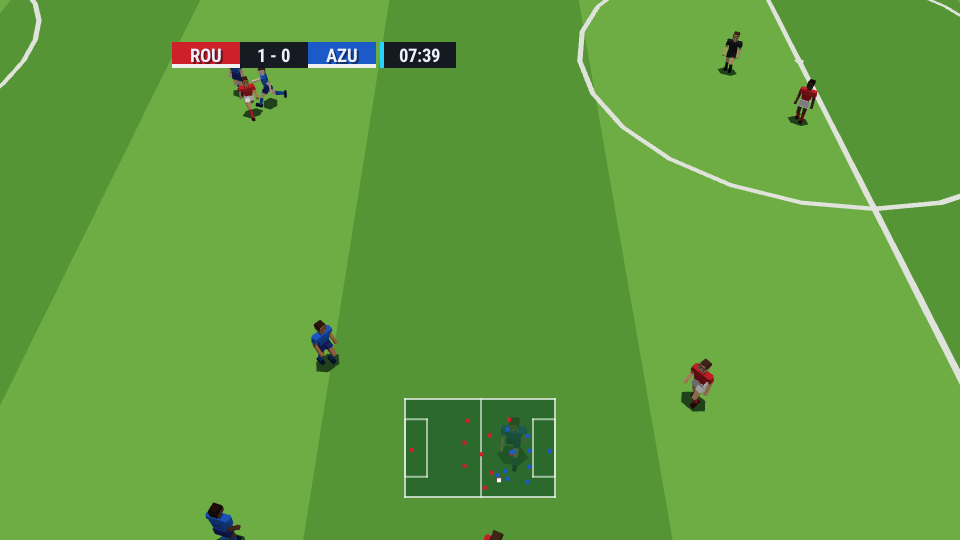
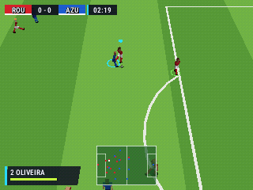
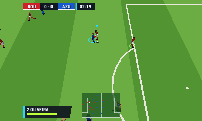
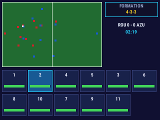
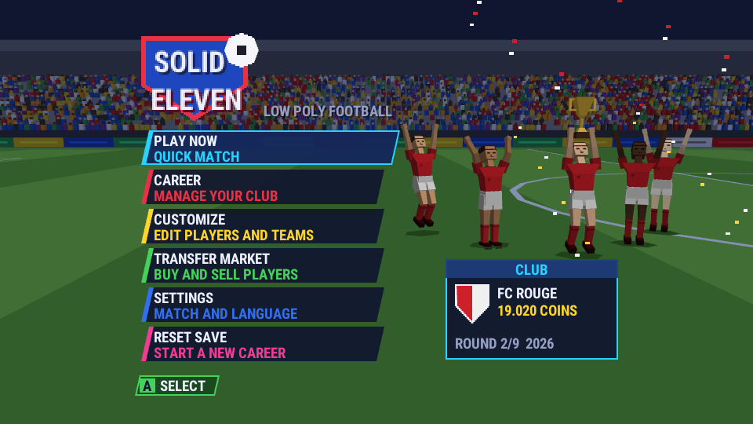
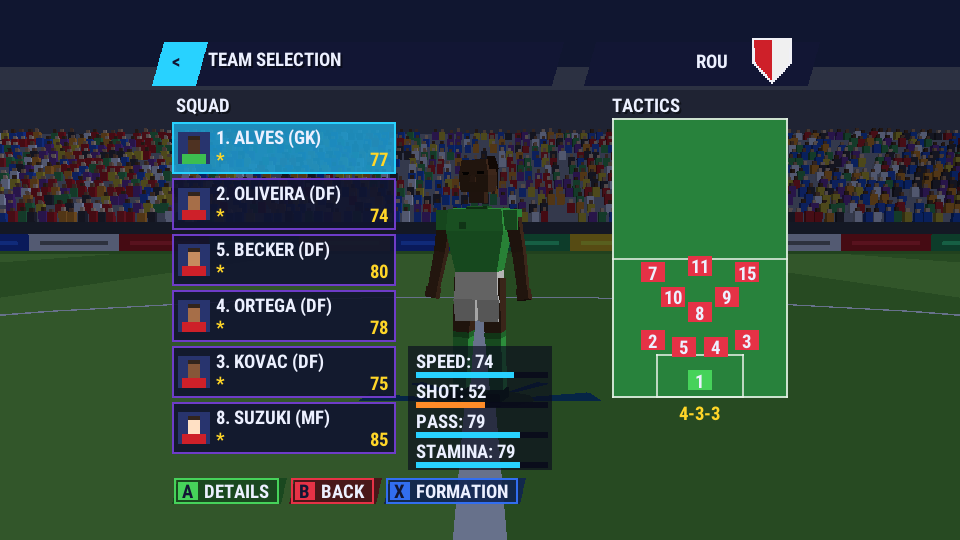
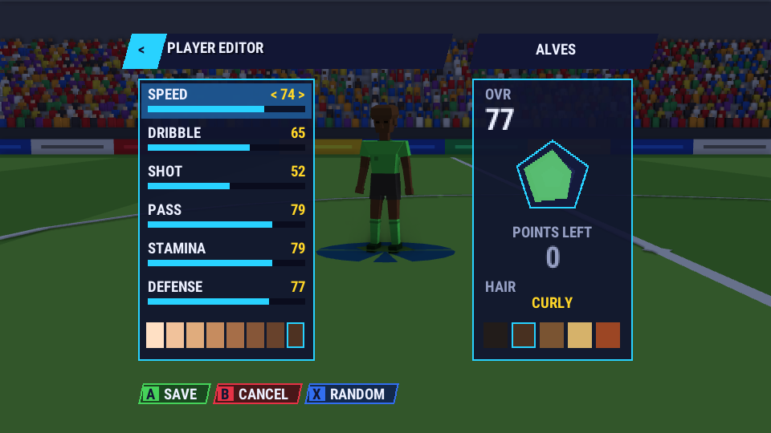
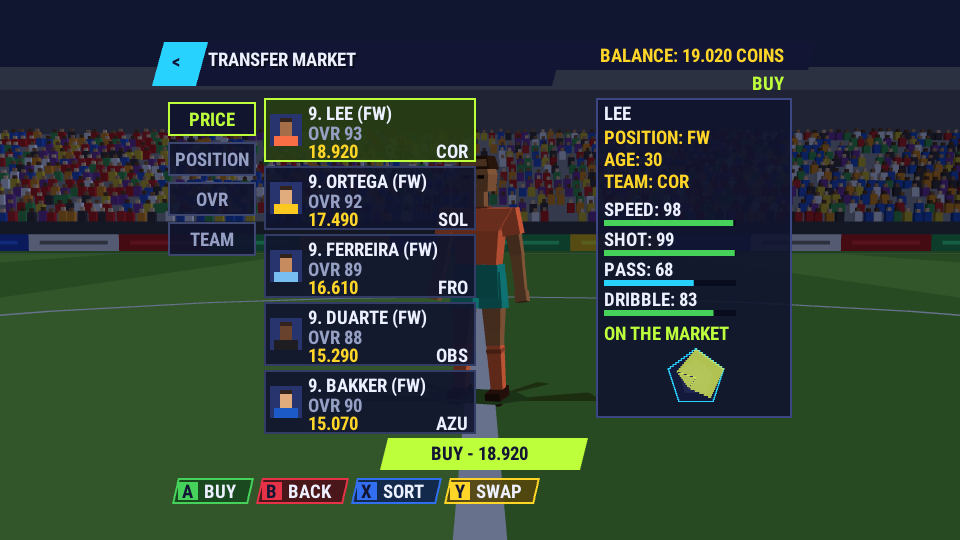
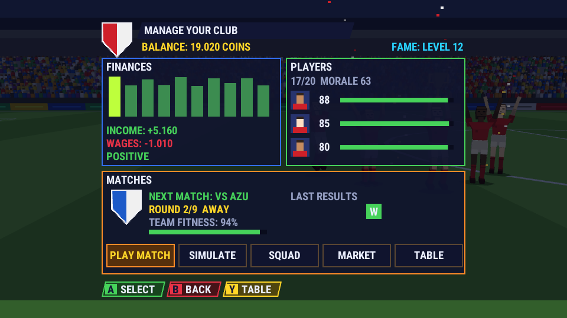
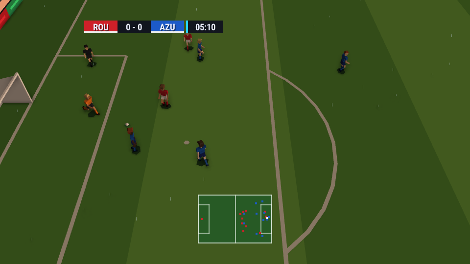

# Solid Eleven: the football demo and template

Solid Eleven is a low-poly 3D football game made with Trino ([issue
#39](https://github.com/vitorjordao/Trino/issues/39)). One crate,
[`examples/solid-eleven`](../examples/solid-eleven), runs on the PC, the
Nintendo 64 and the Nintendo 3DS. It is also the engine's **`football` project
template**:

```sh
cargo xtask new my-football --standalone ../my-football --template football
#   or, from any standalone project:  cargo trino new my-football --standalone <dir> --template football
#   or: the editor's project launcher › Create › football
cd ../my-football && cargo run -p my-football-pc
```

| PC (native) | Nintendo 64 (ares) | Nintendo 3DS (Azahar, both screens) |
|---|---|---|
|  |  | <br> |

| Title | Team selection | Player editor |
|---|---|---|
|  |  |  |
| **Transfer market** | **Club management** | **Rain at dusk (PC tier)** |
|  |  |  |

The UI follows the concept art the issue came with (dark navy panels with neon rims,
slanted headers, stat bars and a radar pentagon, a footer of button hints). Every
panel is `fill_rect` and bitmap text, with no textures, so the menus run on the N64.

## Playing

| Action | PC keyboard | Gamepad | N64 | 3DS |
|---|---|---|---|---|
| Move | WASD / arrows | left stick | stick | circle pad / d-pad |
| Pass (hold: harder) · standing tackle | Z | A | A | A |
| Shoot (hold: power) · sliding tackle | X | B | B | B |
| Through ball / cross (hold: lofted) | C | X | C-left | X |
| Switch player | Q | LB | L | L |
| Sprint | E | RB / RT | R | R |
| Pause (resume, substitute, quit) | Enter | Start | Start | Start |

With the ball, a cyan ring and arrow mark your player and a green ring marks the next
one a switch would pick. Dashes show the lane a pass would take. While a shot is
charged, beads show its path. On the 3DS touch screen you can tap a stamina tile to
take that player, tap the formation box to change it, or tap **Substitute**.

Modes:

- **Quick match:** any two clubs, either side or CPU against CPU, day, dusk or night,
  dry or rain.
- **Career:** pick a club and play a nine-round season. Each round you play or
  simulate the match. Gate money, prize money and wages move the budget. Energy,
  form and morale change between matches, and the table and last results are kept.
- **Customize:** edit any player's six attributes within his point budget, and his
  skin tone. Change formations.
- **Transfer market:** buy from other clubs within your budget and squad limits, or
  sell to the club that can best afford it.
- **Settings:** English or Brazilian Portuguese, difficulty, and the half length.

The career and the settings are saved through `Platform::save_*`. The save is a
1.8 KB fixed layout that fits the N64 cartridge's 2 KB EEPROM. The writes are spread
over frames, and never during a match.

## How it is built

`examples/solid-eleven/src` is one crate, because a game crate may depend only on
`trino-core`. It has four layers, and `xtask/tests/solid_eleven_layers.rs` keeps them
apart:

| Module | What it is |
|---|---|
| `sim/` | The match and the league as pure, deterministic **Q16.16 fixed point** at a 60 Hz tick. It never imports `trino_core` and uses no floats, so the same inputs give the same match bit for bit on every target. `fx.rs` holds the numbers, vectors, RNG and state hash. `ball.rs`: flight, drag, Magnus curl, bounces, roll (faster when wet), posts, bar and net. `rules.rs`: the referee as pure functions. `engine.rs`: the match. `ai.rs`: the tactics. `team.rs`: clubs, attributes and point budgets. `league.rs`: the career and the save. |
| `game/` | Screens, button mapping (kicks charged while held, released to play), the fixed-tick session, the career flow, saves, the end-to-end tests. |
| `render/` | The broadcast camera, game-side culling, the stadium, players posed from the clip tables, the ball, the 3D markers, the HUD, the menus' 3D backdrops. |
| `ui/` | A small immediate-mode toolkit (panels, slants, bars, a radar, crests, hints), every screen, and the strings in two languages. |

### The rules

The rules follow the Laws of the Game, simplified for an arcade match. Each one is a
pure function in `sim/rules.rs`, with a test matrix next to it:

- **Out of play.** A ball wholly over a line restarts by the last touch: a throw-in,
  a goal kick or a corner. A goal is a ball wholly past the line between the posts
  and under the bar.
- **Offside (Law 11).** At each kick the sim records who stands beyond both the ball
  and the second-last opponent, in the opponents' half. Being level is onside.
  Throw-ins, goal kicks and corners are exempt. The offence is called when one of
  those players touches the ball before an opponent plays it, and the linesman on
  that half raises his flag.
- **Fouls (Law 12).** A slide that hits a man before the ball, or a standing
  tackle that loses its duel, is a foul.
  - Careless fouls: no card.
  - Reckless fouls get a yellow: a slide from behind or at speed, or a charge
    into the man's back.
  - Excessive force or denying an obvious goal-scoring opportunity gets a red.
    In the area, a DOGSO foul with a try for the ball gets a yellow instead.
  - Two yellows make a red. A sent-off player leaves, and his side plays with ten.
- **Restarts.** Fouls are direct free kicks, or a penalty in the offender's own
  area. Offside gives an indirect free kick. Opponents stand 9.15 m away; a wall
  forms for a free kick near goal. At a penalty, everyone else is outside the area
  and the arc.
- **The match.** It has two halves, with a kick-off at the start of each and after
  every goal, sides swapped at half time, fatigue, and **three substitutions** from a
  five-man bench at dead balls only. The AI makes them after half an hour; a human
  makes them from the pause menu or the 3DS touch screen.

### The AI

Each side keeps a shape: its formation slid with the ball, compact without it,
stretched with it. The back line is held flat and steps up with the ball, which is the
offside trap. Forwards play on the last defender's shoulder. On top of that, each
player has a job:

- **The carrier** scores his options by the gain in a pitch-value function and by the
  risk:
  - a shot, by the open angle, the distance and his shot attribute;
  - ground passes, checked by an interception timing test along the lane;
  - lofted passes into space;
  - through balls, when the runner reaches the spot before any defender;
  - crosses from wide in the final third;
  - dribbling into space;
  - clearing under pressure in his own third.

  Poor passers sometimes misjudge a tight offside line.
- **Off the ball:** support runs into clear lanes, runs in behind the line, overlapping
  full backs.
- **Out of possession:** the nearest player presses goal-side and tackles according to
  the club's aggression. The second covers, and the rest mark the opponent in their
  zone, goal-side of him.
- **The keeper** positions on the ball–goal line. He reacts after a delay that his
  reflexes set and dives toward the predicted crossing point with an error. He
  catches or parries depending on the shot's pace, claims loose balls in his area,
  and throws or punts.

All ten clubs have distinct tactics: pressing, line height, width, tempo, directness
and aggression. A ten-match AI sample (`sim/tests.rs::ai_matches_play_like_football`)
pins football-like numbers per 6-minute match: goals, shots, pass completion,
possession, every restart type, and fatigue.

### Teams and the economy

The ten fictional clubs each have a home and an away kit, a keeper's color, a crest
and a tactical identity. The away kit is worn when the home shirts clash. Players are
generated from each club's identity and balanced by a **point budget**: every club has
the same total, so clubs differ in style, not strength. Stars, regulars and bench
players have different budgets. The editor enforces the cap: lower one attribute to
raise another. A player's market value is quadratic in his overall rating (an 85 is
worth about 8,700 coins), adjusted for age. Wages are paid every round.

## Art and animation

`cargo xtask blender solid-eleven` runs `tools/blender/solid_eleven_models.py` in
headless Blender. It builds every model from code and gates each one with the engine's
own bake against a triangle budget:

- **The pitch:** 24 coarse tiles and 96 fine ones, with the lines in. The game draws
  a coarse tile far away and its four fine ones near the camera, culled by their exact
  rectangle. A 20 m tile under the camera doesn't fit the N64 RSP's clip band and falls
  back to the CPU.
- **The stadium:** stand sections with their ad boards; consoles get a mosaic crowd,
  the PC a crowd of little people. Also floodlight towers, the goal (two-sided net
  panels, built as faces in both directions), corner flags and the ball.
- **The players:** rigid parts. Consoles get 7 per player (head, torso, shorts with
  the blob shadow, arms, legs), about 98 triangles. The PC gets 11, with elbows and
  knees and more detail. Kits are a per-draw tint, so every part stays on the N64's
  RSP.
- **The markers and menu props:** the cursor rings, the arrow, the pass dashes, the
  trajectory beads, the pedestal.
- **`player_rig.glb`:** every PC part on the skeleton with all 20 clips. It is the
  model `model inspect --anim` and the editor's Animation tab read.

The clips (idle, walk, jog, sprint, dribble, pass, lob, shot, tackle, slide, down,
header, throw-in, celebrate, keeper ready/dive/hold, referee point/card, linesman flag)
live in one table, `tools/blender/solid_eleven_anim.py`. The Blender script keys the
rig from it, and the same script writes `render/clips_gen.rs`, the quaternion keys the
game samples. `solid_eleven_layers.rs` fails when the two drift apart. The game blends
clips (a crossfade, cycles keep their phase), mirrors them (the dive), and poses only
the joints a detail level draws, with no trigonometry per frame.

Sounds (whistle, kicks, crowd, cheers, the menu theme) are synthesized by
`tools/solid_eleven/make_sounds.py`; the PC tier's rain and glow sprites come from
`make_sprites.py`. The UI font is Roboto Condensed Bold (Apache-2.0), baked at 11 and
22 px with the Portuguese accents. On the N64 its atlas is I4 and fits TMEM.

## Platforms and performance

The N64 is the ceiling. Every console draw is opaque, untextured and single-sided, uses
vertex colors and a white light, and stays on the RSP. Dusk and night are a tint on
every draw, not a dimmed light, which would send every draw to the CPU. The world is
drawn at 1/64 scale so the 16-bit depth buffer resolves the 2 cm line strips. The
camera's eye-target offset stays bit-exact while it pans, so the draw memo patches the
stadium instead of rebuilding it.

| Target | The self-test's scripted match (300 frames) |
|---|---|
| N64 (ares) | **PERF_N64** |
| 3DS (Azahar) | **PERF_3DS** |
| PC | **PERF_PC** |

What the PC's native profile adds: higher-detail players, crowd, goal and ball, rain
billboards and the per-pixel wet look, floodlight glows. The 3DS adds its touch screen.

## Tests

| Test | What it proves |
|---|---|
| `sim/rules.rs` | The rules matrix: restarts by last touch, offside position and exemptions, sanctions, penalties, two yellows |
| `sim/ball.rs`, `sim/fx.rs` | Roll, wet roll, loft and bounces, curl, posts, bar, net, pass speed; the fixed-point math |
| `sim/tests.rs` | The AI sample plays like football (every match ends; the score is the goals logged; every restart happens; players tire; the numbers stay in range). A full match with human input is deterministic. Substitutions follow the rules. |
| `sim/team.rs`, `sim/league.rs` | Balanced clubs, the point cap, values; fixtures, a season, the table and the books, transfers and squad limits, lineups, the save's round trip and size |
| `game/e2e.rs` | Through the buttons only: a quick match from the title to the report with a bot playing the human side; a career round, a purchase and an edit that survive the save on a 2 KB cart; quitting a career match; every screen drawn on every profile |
| `render/anim.rs`, `game/input.rs`, `game/menu.rs`, `ui/*` | Clips, mirroring, crossfades, the yaw without trigonometry, input charge and arming, menu repeat and taps, the UI canvas and shapes, every string in the font |
| `xtask/tests/solid_eleven_budget.rs` | Every draw of the scripted match stays on the N64's RSP. Its cost per sampled frame (draws, triangles, the 3DS GPU's share, the 2D overlay) is pinned in `tests/perf/solid_eleven_work.toml`. |
| `xtask/tests/solid_eleven_layers.rs` | The layer rules, the fonts' characters, the clip tables against their source |
| `xtask/tests/solid_eleven_render.rs` | PC golden frames (N64 look, 3DS look, native) |
| The template's self-tests (`templates/football/{n64,n3ds}`) | In ares and Azahar, run by CI: the scripted match, the frame budget, the sim hash equal to the PC's, golden frames |
| `crates/scaffold` | `--template football` copies the game, its own assets and the console hosts |

## Using it as a template

A project made with `--template football` contains the whole game. Its README is
`AGENTS.md`. Common changes:

| To change | Edit |
|---|---|
| Clubs, kits, crests, tactics | `game/src/sim/team.rs` (`CLUBS`) |
| Formations | `team.rs` (`FORMATIONS`: slots in team space, a role each) |
| How players decide | `game/src/sim/ai.rs` (`carrier`, `support`, `press`, `keeper`) |
| Rules | `game/src/sim/rules.rs` and its matrix |
| Season, money, transfers | `game/src/sim/league.rs` |
| Strings and languages | `game/src/ui/i18n.rs` (keep to the font's `FONT_CHARS`) |
| Screens | `game/src/ui/screens.rs`, flows in `game/src/game/app.rs` |
| Models | `assets/shared/models/*.glb` (the engine's `tools/blender/solid_eleven_models.py` builds them) |

After a change to how the match plays or looks, re-pin
`selftest::EXPECTED_HASH`; `cargo test` prints the new hash. Then re-bless the
console goldens with `cargo trino test n64 --bless` and
`cargo trino test 3ds --bless`.
